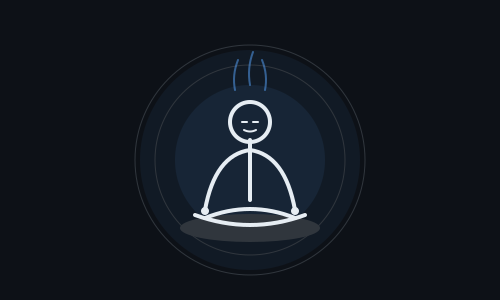

# 👋 Hi, I'm Oludemi Joshua

### Cybersecurity Engineer | Blue Team | Cloud Security | Security Automation

Building practical security projects across **SOC Engineering, Cloud Security, Detection Engineering, Network Security, Identity & Access Management, and Security Automation.**

---

## 🛡️ About Me

I'm a cybersecurity-focused builder interested in **Blue Team operations, cloud security, detection engineering, security automation, and secure software development**.

I enjoy turning what I learn into practical labs and security projects — from building Azure honeypot environments and analyzing attack telemetry to automating Active Directory operations and developing security-focused applications.

My approach is simple:

> **Learn → Build → Test → Document → Improve**

I'm currently developing my skills toward roles in **Cybersecurity, SOC/Blue Team, Cloud Security, Security Engineering, and DevSecOps.**

---

## 🔭 Currently Building

### 🛡️ HEX WATCH — AI-Native Security Operations Platform

HEX WATCH is an ongoing security engineering project exploring how modern SOC workflows can be combined with automation and AI-assisted analysis.

Current areas of development include:

- Security event ingestion
- Threat detection
- Alert correlation
- Incident management
- Investigation workflows
- Security automation
- AI-assisted security analysis
- SOC workflow design

> HEX WATCH is an evolving project. Features are developed incrementally as I expand my knowledge in cybersecurity, software engineering, and cloud security.

---

## 🚀 Featured Security Projects

### ☁️ Azure Honeypot SOC Lab V2

A cloud-based security lab designed to generate and analyze real-world attack telemetry.

**What I worked with:**

- Azure infrastructure
- Microsoft Sentinel
- Log Analytics
- KQL
- Data Collection Rules
- Windows telemetry
- Linux honeypots
- Attack-source analysis
- Security monitoring

**Focus:** Cloud Security • SOC Operations • Detection • Threat Analysis

---

### 🔐 Hex Watch Cipher

A browser-based cryptography application built around **client-side encryption and privacy-focused design**.

**Features include:**

- AES-256-GCM encryption
- AES-256-CBC + HMAC-SHA-256
- RSA-OAEP hybrid encryption
- File encryption
- Password-based key derivation
- Workspace/session locking
- Security configuration controls
- Local browser-based cryptographic operations
- Built-in calculator and security-focused UI

**Technology:** JavaScript • Web Crypto API • HTML • CSS

> Cryptographic operations are performed locally in the browser rather than sending plaintext data to a backend server.

---

### 🪟 Active Directory PowerShell Automation Toolkit

A PowerShell-based toolkit for automating and managing Active Directory lab environments.

**Focus areas:**

- User provisioning
- Account lifecycle management
- Department-based organization
- Administrative delegation
- Auditing
- Reporting
- Controlled destructive operations
- `-WhatIf` / `-Confirm` safety controls
- Structured operation logging
- Credential protection

**Technology:** PowerShell • Active Directory • JSONL • CSV • Windows Server

---

### 🌐 Enterprise Network Security Lab

A large Cisco Packet Tracer enterprise network designed around segmentation, redundancy, routing, and access control.

**Implemented concepts include:**

- VLAN segmentation
- Inter-VLAN routing
- OSPF
- HSRP
- EtherChannel
- STP
- DHCP relay
- ACLs
- NAT
- SSH
- Wireless networking
- VoIP

**Focus:** Network Engineering • Network Security • Infrastructure

---

## 🧰 Security & Engineering Stack

### 🛡️ Cybersecurity
`Blue Team` `SOC` `Detection Engineering` `Security Monitoring` `Threat Analysis` `Vulnerability Management` `OSINT` `Digital Forensics`

### ☁️ Cloud & Security Operations
`Microsoft Azure` `Microsoft Sentinel` `Log Analytics` `KQL` `Bicep`

### 🪟 Windows & Identity
`Windows Server` `Active Directory` `PowerShell` `Group Policy` `IAM`

### 🌐 Networking
`TCP/IP` `VLANs` `OSPF` `HSRP` `STP` `EtherChannel` `ACLs` `NAT` `SSH`

### 🐍 Development & Automation
`Python` `FastAPI` `JavaScript` `REST APIs` `PowerShell` `Git` `Docker`

### 🔐 Applied Cryptography
`AES-256-GCM` `AES-256-CBC` `HMAC-SHA-256` `RSA-OAEP` `PBKDF2` `Web Crypto API`

---

## 📚 Professional Certifications & Learning

### 🎯 Currently Preparing

- **Microsoft SC-900 — Security, Compliance, and Identity Fundamentals**
- **CompTIA Security+**
- **Comptia SECAI+**

### 📜 Completed Training & Education

- Bsc Cybersecurity < 4:2 >
- Cisco Python Essentials
- Cisco Networking Basics
- Ethical Hacking Essentials
- Blue Team Junior Analyst
- Vulnerability Management
- Threat Hunting
- Digital Forensics
- OSINT
- Dark Web Operations

---

## 📈 What I'm Currently Improving

I'm continuously developing practical experience in:

- SOC workflows and alert triage
- Detection engineering
- KQL
- Microsoft Sentinel
- Azure security
- Network security
- Windows security
- Active Directory
- Python security automation
- Secure application development
- DevSecOps practices

---

## 🎯 Career Direction

I'm interested in opportunities around:

**Cybersecurity Analyst • Junior SOC Analyst • Blue Team • Cloud Security • Security Engineering • Security Automation • DevSecOps**

My goal is to build security solutions that combine **infrastructure, automation, software engineering, and cybersecurity.**

---

## 📫 Connect With Me

---

### 🧠 Learn. Build. Secure. Improve.

